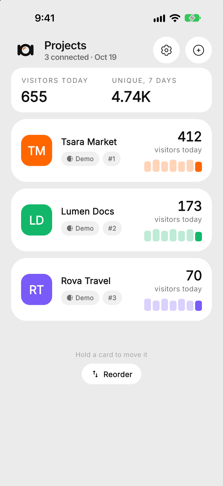
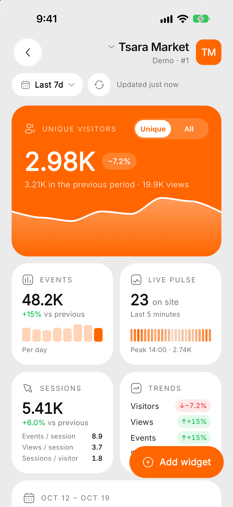
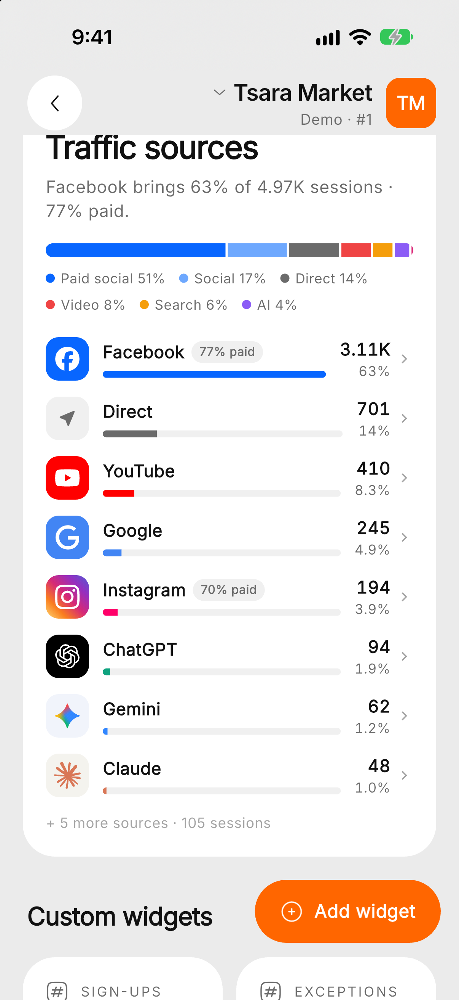
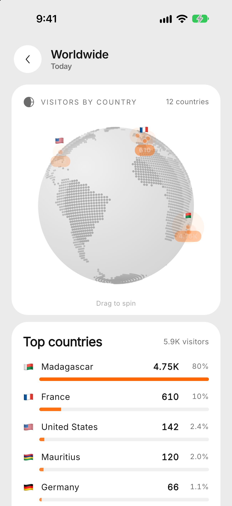

<p align="center">
  
</p>

<h1 align="center">HogLens</h1>

<p align="center"><b>All your PostHog projects. One lens.</b></p>

<p align="center">
  <a href="https://github.com/Diary-Axel-RAKOTOARIVAO/HogLens/releases/latest"></a>
  <a href="LICENSE"></a>
  
  
  
</p>

HogLens is a free, open-source mobile app for [PostHog](https://posthog.com). Add any number of projects with a personal API key, give each a name, a logo and an accent color, and see unique visitors, traffic sources, live events, errors, retention and a 3D globe of where your visitors are. Anything else you track goes into custom widgets backed by HogQL. Everything you've loaded stays available offline.

<p align="center">
  <picture>
    <source media="(prefers-color-scheme: dark)" srcset="screenshots/dark/02-projects.png">
    
  </picture>
  <picture>
    <source media="(prefers-color-scheme: dark)" srcset="screenshots/dark/03-dashboard.png">
    
  </picture>
  <picture>
    <source media="(prefers-color-scheme: dark)" srcset="screenshots/dark/04-traffic-sources.png">
    
  </picture>
  <picture>
    <source media="(prefers-color-scheme: dark)" srcset="screenshots/dark/13-worldwide.png">
    
  </picture>
</p>

## Download

Android APKs are attached to every [release](https://github.com/Diary-Axel-RAKOTOARIVAO/HogLens/releases). Pick the one for your phone. If you're not sure, take **arm64**, which fits almost every phone from the last few years.

| Phone | Download |
| --- | --- |
| Most phones (64-bit) | [hoglens-arm64.apk](https://github.com/Diary-Axel-RAKOTOARIVAO/HogLens/releases/latest/download/hoglens-arm64.apk) |
| Older phones (32-bit) | [hoglens-armv7.apk](https://github.com/Diary-Axel-RAKOTOARIVAO/HogLens/releases/latest/download/hoglens-armv7.apk) |
| Emulators and x86 devices | [hoglens-x86_64.apk](https://github.com/Diary-Axel-RAKOTOARIVAO/HogLens/releases/latest/download/hoglens-x86_64.apk) |

These links always serve the newest version. Each release lists what changed and the SHA-256 of every file, and the app tells you in Settings when a new version is out. iOS has no prebuilt download yet; build it from source (see [Development](#development)).

## Features

- **Many projects.** US Cloud, EU Cloud or self-hosted, each with its own name, logo and accent color. Drag to reorder.
- **Dashboard.** Unique visitors, events, sessions, live pulse and trends with deltas against the previous period, over Today, 24h, 7d, 30d, this month or a custom window.
- **Traffic sources.** Channel breakdown (search, social, direct, referral, AI, email…) and the top sources with their logos, down to UTM campaigns.
- **Custom widgets.** Any HogQL query as a number, trend, bar list or table, half or full width, reorderable, with a preset gallery to start from.
- **Live feed.** The newest events, refreshed every ten seconds, filterable by event name.
- **Errors.** `$exception` events grouped by type and message, with counts, people affected and a trend.
- **Behavior.** Top events with drill-down, user lifecycle, weekly retention and navigation paths.
- **Worldwide.** Visitors by country on a rotating 3D globe, plus a ranked list.
- **Feature flags** per project.
- **Android home-screen widgets.** Six sizes from 2×1 to 4×3, each with its own project and period, refreshed in the background.
- **Offline.** Everything already loaded still opens without a network.
- **English and French**, light and dark themes that follow the system.
- **Demo project** with fake data, so you can look around without a key.

## Your data

HogLens talks only to the PostHog host you choose. Your personal API key is stored in the iOS Keychain or Android encrypted storage and is never sent anywhere else. There is no HogLens server, no analytics and no account.

## Connecting a project

1. In PostHog go to Settings → Personal API keys and create a key with at least the `project:read`, `query:read` and `feature_flag:read` scopes.
2. In HogLens tap **Add project**, choose the host, paste the key and tap **Connect**.
3. Pick a project. Project-scoped keys cannot list projects directly, so the app falls back to the organization's team list and validates the pick; you can also type the numeric project ID from the PostHog URL.
4. Name it, upload a logo, pick an accent.

## Custom widgets

Widgets run a HogQL query through `POST /api/projects/:id/query/`. Use `{range}` (window start) and optionally `{range_end}` in the query to follow the dashboard range, for example:

```sql
SELECT count() FROM events WHERE event = 'user signed up' AND timestamp >= {range}
```

- **Number** shows the first cell of the first row. Turn on "Compare with previous period" to also show the change versus the window before.
- **Trend** expects rows of `(time, value)`.
- **Bars** expects rows of `(label, value)`.
- **Table** renders the raw result, up to ten rows.

PostHog limits personal keys to three concurrent queries and 240 requests per minute; the client serializes calls accordingly.

## Development

You need the [Flutter SDK](https://docs.flutter.dev/get-started/install) (Dart `^3.13.2`).

```bash
flutter pub get
flutter run
```

```bash
flutter analyze && flutter test
```

Live check against a real host (skipped when the variables are absent):

```bash
PH_KEY=phx_… PH_PROJECTS=12345 flutter test test/live_api_test.dart -r expanded --concurrency=1
```

Layout:

- `lib/core` theme tokens and formatters
- `lib/data` models, secure storage, API client, stats queries, Riverpod providers
- `lib/features` projects, dashboard, custom widgets, flags, behavior, errors, worldwide, settings
- `lib/shared` reusable UI pieces
- `android/` native home-screen widgets (Kotlin)
- `tool/release.sh` builds the three APKs and publishes a GitHub Release from `CHANGELOG.md`

Release builds are signed with a key kept outside the repo (`android/key.properties`); without it, `flutter build` falls back to the debug key.

## Contributing

Issues and pull requests are welcome. Found a bug or want a feature? [Open an issue](https://github.com/Diary-Axel-RAKOTOARIVAO/HogLens/issues/new). Please run `flutter analyze && flutter test` before sending a PR, and add a line under `[Unreleased]` in [CHANGELOG.md](CHANGELOG.md).

## Built with Claude

HogLens was built with the assistance of [Claude](https://claude.com) (Anthropic), used through [Claude Code](https://claude.com/claude-code), for the code, tests, documentation and release tooling. The project is directed and maintained by [Axel RAKOTOARIVAO](https://github.com/Diary-Axel-RAKOTOARIVAO).

## License

[MIT](LICENSE) © 2026 Axel RAKOTOARIVAO. Traffic-source logos keep their own licenses and trademarks, see [assets/sources/LICENSES.md](assets/sources/LICENSES.md).

HogLens is an independent project and is not affiliated with or endorsed by PostHog.
